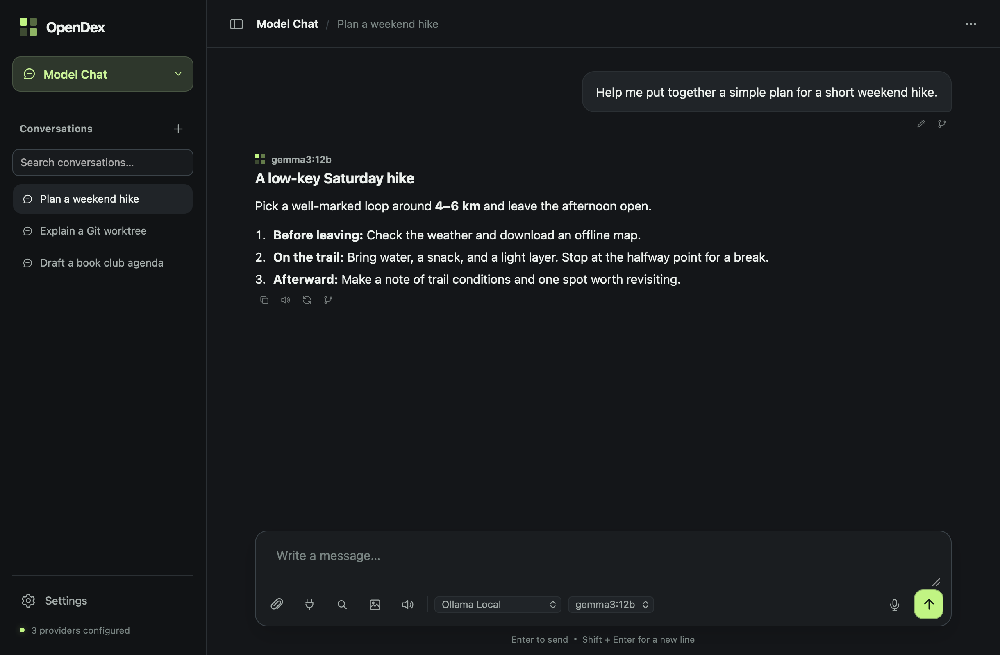
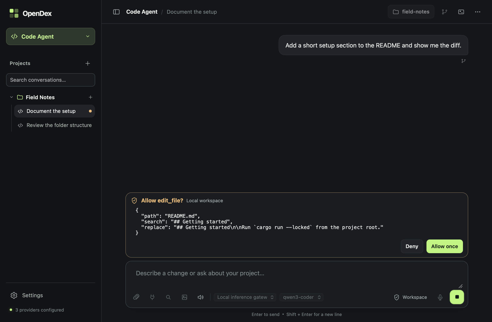
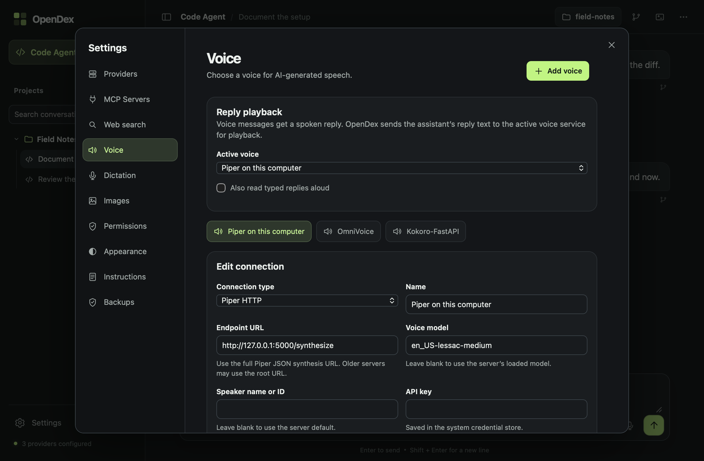
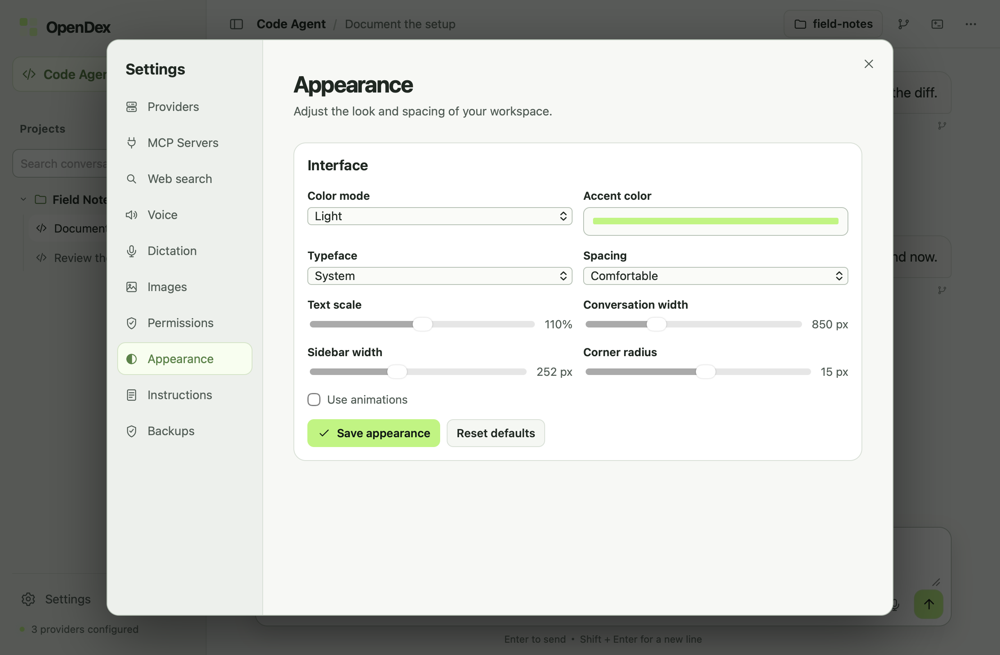

# OpenDex

OpenDex is a desktop workspace for chatting with AI models and working on local projects with a coding agent. Connect local inference servers, hosted APIs, or supported account-backed command-line tools, then switch models from the composer. OpenDex stores conversations on your computer and works without an OpenDex account.

- **Model Chat** streams conversations, accepts attachments, and lets you edit or branch from earlier messages.
- **Code Agent** can inspect and edit a project, run permitted commands, and review Git changes. OpenDex shows approval prompts based on your permissions.
- **Independent services** let you choose separate providers for chat, web search, image generation, speech, and dictation.
- **MCP connections** add tools, resources, and reusable prompts. A paired Hermes connection can handle approved tasks on a VPS while OpenDex continues to run workspace tools locally.

The first release is available as an [Apple Silicon macOS download](https://github.com/dylanmaniatakes/OpenDex/releases/tag/v1.0.0). Apple Silicon macOS is the tested desktop platform so far. See [platform plans and ways to help](#roadmap-and-community) for Linux and Windows.



Screenshots use sample conversations and connections in the unbundled frontend.

## Contents

- [Quick start](#quick-start)
- [Connect providers](#connect-providers)
- [Work on a project](#work-on-a-project)
- [Connect a remote agent](#connect-a-remote-agent)
- [MCP and web search](#mcp-and-web-search)
- [Generate images](#generate-images)
- [Voice and dictation](#voice-and-dictation)
- [Customize your workspace](#customize-your-workspace)
- [Data, privacy, and backups](#data-privacy-and-backups)
- [Build and test](#build-and-test)
- [Roadmap and community](#roadmap-and-community)

## Quick start

1. Download OpenDex for Apple Silicon macOS, unzip it, and move `OpenDex.app` to Applications. The build is ad-hoc signed and distributed without notarization. See [Build and test](#build-and-test) to run it from source.
2. Choose an existing model in **Model Chat**. For a running local Ollama server, use **Find local models**. For another service, go to **Settings → Providers → Add provider**, choose an adapter, and enter the service URL and credentials.
3. Save the connection. Choose **Discover models** and add the models you want in the picker, or enter model IDs manually with **Add models**.
4. Select the provider and model in the composer and send a message. **Enter** sends, **Shift+Enter** inserts a new line, and **Stop** interrupts a running turn.
5. To work on a project, switch to **Code Agent** using the sidebar mode menu, choose **Add project**, and select a folder.

Use the paperclip or drag files onto either composer to attach them. OpenDex accepts up to eight UTF-8 text files, supported images, or PDFs totaling 200 MiB per message. The selected model or endpoint may impose a lower file, request, or context limit. Large images appear in the conversation as file labels.

Search the sidebar for saved conversations, message text, projects, attachment names, providers, models, and tool names. Search runs locally. In Model Chat, editing a prompt or retrying a reply starts a branch and preserves the original conversation. **Branch from here** is available in both modes. Use **Conversation settings** to rename, export, or add instructions to a conversation.

## Connect providers

| Adapter | Setup |
| --- | --- |
| OpenAI API | Enter an API key. The adapter uses the Responses API at `https://api.openai.com/v1`. |
| ChatGPT Account | Install the [Codex CLI](https://developers.openai.com/codex/cli/), add the adapter, and choose **Connect account** to open the official sign-in flow. |
| Anthropic API | Enter an Anthropic Console API key. The adapter uses the Messages API at `https://api.anthropic.com/v1`. |
| Claude account | Add an Anthropic connection, select **Claude account** under **Anthropic access**, and save. Install [Claude Code](https://code.claude.com/docs/en/setup), configure its executable path if needed, and choose **Connect account**. |
| Google Gemini API | Enter a Google AI Studio API key. The adapter uses the native Gemini API at `https://generativelanguage.googleapis.com/v1beta`. |
| Ollama Local | Start Ollama and pull a model. The default endpoint is `http://127.0.0.1:11434/api`. |
| Ollama Cloud | Set an Ollama API key for cloud inference. Use **Search Ollama** for the public catalog, **Fetch Cloud tags** for the endpoint's list, or add model IDs manually. |
| OpenAI-compatible | Enter a Chat Completions base URL, including its API prefix such as `/v1`. Add a key if the endpoint requires one. This works with compatible inference servers such as LM Studio. |

Under **Advanced connection settings**, you can set a custom API key header or add headers in `HEADER_NAME=ENVIRONMENT_VARIABLE` form. Use the base URL for the service's inference API. Discovering a model confirms that it is advertised by the endpoint. Tool calling, images, PDFs, and reasoning are model- and adapter-dependent.

The Codex and Claude Code executables manage their own account sign-ins. OpenDex gives them dedicated configuration directories and routes the tools it exposes through its permission layer. CLI account support depends on the installed version and account eligibility.

## Work on a project

Select a project folder in **Code Agent** and ask the model to inspect files, make a change, or run checks. **Review changes** shows Git status and diffs. For a separate checkout, create a Git worktree from the conversation toolbar. Threads that share a project directory run workspace turns one at a time.

A tool-capable model in Model Chat can also request a handoff to Code Agent while keeping the conversation. Choose a preferred folder under **Conversation settings → Code Agent handoff project**, or approve a folder when prompted. You can also ask OpenDex to create a named project in an existing parent folder. It shows the exact destination for approval before creating it.

### Permissions

OpenDex supplies the active model with the tools available for the current turn and checks each tool call against your settings.

| Profile | Behavior |
| --- | --- |
| **Workspace** | Default. Allows project reads and prompts for writes, commands, MCP calls, and web requests. Scoped command networking is disabled. |
| **Read only** | Allows inspection of the selected project. |
| **Custom** | Configure permissions for file access, commands, MCP, and web requests. You can also set scoped command networking and a tool-call limit. |
| **Full access** | Runs workspace commands with your desktop user's privileges and network access. MCP calls and web requests still prompt. |

Workspace and Custom shell command isolation currently use macOS Seatbelt. On other platforms, scoped commands are unavailable. Full access permits unisolated shell commands. Built-in file tools enforce project path checks. Local MCP executables start separately with your desktop user's privileges, so only configure servers you trust.



## Connect a remote agent

A server-agent endpoint such as the Hermes Agent API can run tools on its own host. To keep workspace work on your machine and optionally delegate VPS tasks, pair that endpoint with a separate inference model.

1. Save the Hermes Agent API as an **OpenAI-compatible** provider. Use its API base URL and credentials.
2. Save a tool-capable inference connection. This can be a local model, a hosted inference API, or the [Hermes subscription proxy](https://hermes-agent.nousresearch.com/docs/user-guide/features/subscription-proxy).
3. In the Hermes provider's settings, choose that inference model under **Local execution model**. Select the Hermes connection in the composer to use the pair. The paired model handles the conversation and OpenDex runs workspace tools locally.
4. To allow delegation, enable **Allow Hermes VPS tasks and relay command approvals**. OpenDex shows the exact task before sending it. It relays reviewable command requests from Hermes as **Allow once** or **Deny** prompts. The remote server's policy determines which commands require its approval.

Delegation needs a server that advertises the [Hermes Runs API](https://hermes-agent.nousresearch.com/docs/user-guide/features/api-server) and approval events. Direct Hermes Agent mode is available for explicitly remote Model Chat. OpenClaw agent targets can be paired for local work. The pairing follows the published [OpenClaw documentation](https://docs.openclaw.ai/gateway/openai-http-api) and still needs live testing. Native approvals use the separate [OpenClaw Gateway protocol](https://docs.openclaw.ai/gateway/protocol).

## MCP and web search

### MCP

Open **Settings → MCP Servers** and add a local stdio executable or a Streamable HTTP server. Use **Test & list tools** to check the connection and configure per-tool permissions.

- For stdio, enter an executable and a JSON array of arguments. Use `NAME` to pass an environment variable from OpenDex's process or `NAME=VALUE` for a fixed value. Prefer inherited environment variables for secrets.
- For HTTP, enter the server URL. You can add a bearer key or use `HEADER_NAME=ENVIRONMENT_VARIABLE` entries.
- Use **Conversation settings → MCP servers** to choose which enabled servers a conversation can access. The most restrictive applicable permission governs a tool call.

From either composer, **Add MCP context** lets you preview and attach a resource, fill in a resource URI template, or render a prompt into the draft. The server settings include a protocol selector for initialized MCP sessions and the July 2026 revision. [MCP transport specification](https://modelcontextprotocol.io/specification/2026-07-28/basic/transports)

### Web search

In **Settings → Web search**, add a [SearXNG](https://docs.searxng.org/dev/search_api.html) search URL with JSON output enabled, or choose a saved [Ollama Cloud](https://docs.ollama.com/capabilities/web-search) connection. Ollama Cloud can also fetch a page's main text. Enable **Web search** in the composer for each conversation that needs it.

Use **Test search** to check connectivity. For a SearXNG `403`, check that JSON is enabled in [`search.formats`](https://docs.searxng.org/admin/settings/settings_search.html#formats). Use the final search URL, including any path added by a reverse proxy. Approval prompts show the search query or page URL before sending.

## Generate images

Add one or more named sources in **Settings → Images**. Presets include OpenAI, Google Gemini and Imagen, Adobe Firefly, Stability AI, Black Forest Labs FLUX, fal, Replicate, Ideogram, Recraft, xAI, OpenRouter, Together AI, ComfyUI, and AUTOMATIC1111 or Forge. There are also OpenAI-compatible and custom JSON options.

Choose **Generate image** in either composer for manual generation, or ask a tool-capable model to generate using a named source. OpenDex shows the source and prompt for approval on a model-initiated request. **Save image** exports the result in its original format.

### ComfyUI

1. Save the ComfyUI server's base URL as an image source. The connection can start with an empty workflow.
2. Browse saved workflows and choose an API-format workflow for generation. Include a **Save Image** node and select the positive prompt input, or mark it with `{{prompt}}`. Editor-format workflows can be previewed and exported from ComfyUI in API format.
3. To build a new workflow, ask the model to inspect the installed nodes and use your guidance. OpenDex checks the draft against the node definitions and shows it for approval before saving a new server file. Generating with it is a separate action.

For a custom JSON service, set the full POST URL and use `{{prompt}}` in the request body. If needed, set a JSON Pointer such as `/images/0/url` to find the image in the response. Supported responses include raster bytes, Base64, and image URLs. You can allow a separate HTTPS asset host under **Advanced request settings**. OpenDex fetches assets from that host without forwarding the generation credentials. [ComfyUI server routes](https://docs.comfy.org/development/comfyui-server/comms_routes)

## Voice and dictation

Configure speech input and output independently.

| Setting | Options |
| --- | --- |
| **Settings → Voice** | Add a speech connection, preview the saved voice, and select it as the active voice. |
| **Settings → Dictation** | Local Whisper, OpenAI, ElevenLabs, or an OpenAI-compatible transcription endpoint. |

| Voice connection | Setup |
| --- | --- |
| [Piper HTTP](https://github.com/OHF-Voice/piper1-gpl/blob/main/docs/API_HTTP.md) | Enter the full synthesis URL, typically `http://127.0.0.1:5000/synthesize`. Use the root URL for an older HTTP server that accepts JSON there. Leave the model and speaker blank to use the server defaults. For a multi-speaker model you can enter a speaker name or numeric ID. |
| [OmniVoice](https://github.com/maemreyo/omnivoice-server) | Use your server’s OpenAI-compatible speech URL. The preset starts with `http://127.0.0.1:8880/v1/audio/speech`, model `omnivoice`, and voice `auto`. Use the URL, model, and voice IDs documented by your server wrapper. |
| [Kokoro-FastAPI](https://github.com/remsky/Kokoro-FastAPI) | Use the server’s `/v1/audio/speech` URL and choose an installed voice, such as `af_heart`. |
| Pocket TTS | Enter the full `/tts` URL. Choose a voice, provide its URL, or leave the field blank for the server default. |
| OpenAI and ElevenLabs | Add an API key and choose a speech model and voice. |
| [Cartesia Sonic](https://docs.cartesia.ai/api-reference/tts/bytes) | Add an API key, speech model ID, and voice ID. |
| [Deepgram Aura](https://developers.deepgram.com/reference/text-to-speech/speak-request) | Add an API key and a voice model ID, such as `aura-2-thalia-en`. |
| OpenAI-compatible | Enter the full speech endpoint URL, model ID, voice ID, and authentication if required. Use this option for a Hermes server that exposes OpenAI-compatible speech. |

For local Whisper, choose a listed model or an existing Whisper GGML `.bin` file. To install a listed model, save your selection, choose **Download selected model**, and approve the download. OpenDex verifies the downloaded size and checksum before installing it. [Whisper model files](https://github.com/ggml-org/whisper.cpp/blob/master/models/README.md)

Click the mic beside **Send** to start recording. Click it again to stop, transcribe, and send. You can cancel while recording. If sending fails before the message is accepted, the transcript stays in the draft. With an active voice, spoken messages receive both text and audio. Typed messages stay silent by default. Enable **Also read typed replies aloud** or use a reply's speaker button to hear them.



## Customize your workspace

OpenDex lets you choose where each part of your workflow runs. You can chat through a local inference server, generate images on a self-hosted ComfyUI machine, and use a separate voice service. You can also keep your entire workflow local with compatible services. Choose the endpoints you trust for the data they receive.

- **Appearance.** Under **Settings → Appearance**, choose a light, dark, or system theme, an accent color, a typeface, and a spacing preset. Adjust text size, conversation width, sidebar width, corner radius, and animations. Preview changes before saving, or restore the defaults.
- **Models and services.** Pin the models you want in the picker and switch between them from the composer. Configure your own compatible endpoints for inference, speech, dictation, and image generation. Web search and MCP connections are optional.
- **Instructions and project workflow.** Use **Settings → Instructions** for standing preferences. Add conversation-specific instructions, select which MCP servers that conversation can use, and choose a project for the Code Agent handoff.
- **Permissions and data.** Choose how much access tools get and when they ask for approval. Keep workspace commands local, and opt into paired Hermes VPS delegation when you need it. Store your workspace in a directory you choose and transfer settings with an encrypted backup.



## Data, privacy, and backups

- OpenDex stores conversations, attachments, settings, and project links in its local workspace. To select another data directory, use `--data-dir` or set `OPENDEX_DATA_DIR`. The app supports one running copy per desktop user.
- Saved API and MCP bearer keys use the operating system's credential store. The workspace contains conversation content and configuration. Treat it as private, especially if you enter fixed MCP environment values.
- Model endpoints receive conversation context, attachments, and relevant tool results. Search, image, and remote task requests go to their configured services. Endpoint dictation sends recordings to its transcription service. Speech playback sends reply text to the active voice service.
- A Markdown conversation export includes prompt and reply text, tool outputs, and attachment and MCP resource metadata. Review it before sharing.

In **Settings → Backups**, create a passphrase-protected [age](https://age-encryption.org/v1) archive of connections, selected models, saved keys, service settings, permissions, instructions, and project links. Restoring an archive lets you review and remap project locations. Existing conversations remain in the destination workspace. Backups carry project links and settings without copying project files, conversation history, or downloaded Whisper models. Some CLI-managed sessions may require signing in again after restoring.

## Build and test

### Prerequisites

- **Rust 1.95 or newer** with Cargo. Use the checked-in `Cargo.lock`.
- Platform dependencies from the [Tauri v2 prerequisites guide](https://v2.tauri.app/start/prerequisites/), including the native webview and C/C++ toolchain.
- CMake and LLVM/Clang with `libclang` for the Whisper bindings. On Linux, also install the ALSA development headers (for example, `libasound2-dev` on Debian or Ubuntu).
- Git for worktrees and diffs. Node.js 22 or later is needed for frontend tests. The frontend itself needs no Node build step.

On Windows, set up the MSVC C++ tools and WebView2. On Linux, install the development libraries for WebKitGTK 4.1 and the Tauri dependencies for your distribution. On macOS, install the Xcode Command Line Tools. See the [Whisper build notes](https://docs.rs/crate/whisper-rs/0.16.0/source/BUILDING.md) if CMake or `libclang` fails to resolve.

### Run from source or build a release executable

From the repository root, run one of the following commands.

```sh
cargo run --locked
cargo build --locked --release
```

The release executable is under `target/release/` by default. It is named `opendex` or `opendex.exe` on Windows. To package it for your platform, see [Tauri distribution](https://v2.tauri.app/distribute/). The checked-in packaging helper produces a macOS app bundle and a build manifest in `dist/`. The bundle is ad-hoc signed for local use. The release verifier expects a clean, committed source checkout.

```sh
bash scripts/bundle-macos.sh release
python3 scripts/verify-release.py
```

### Run tests

```sh
node --test tests/*.mjs
cargo fmt --all -- --check
cargo clippy --locked --all-targets -- -D warnings
cargo test --locked
cargo test --locked --no-default-features --all-targets
```

On shells with Bash, `bash scripts/check.sh` runs the full set. The no-default-features suite exercises the core without the desktop feature. The default suites use fixtures for provider and MCP requests and do not need service credentials. See [`tests/`](tests/) for optional tests that use installed CLI tools.

The screenshots were captured from the source HTML, CSS, and JavaScript with a simulated desktop bridge. That check exercised model selection, sidebar search, attachment submission, both approval choices, voice settings, and saving appearance. It covers the frontend interactions independently of live services and native tool execution.

### Source layout

| Path | Responsibility |
| --- | --- |
| [`src/desktop.rs`](src/desktop.rs) | Desktop commands, conversation turns, and approval prompts |
| [`src/agent.rs`](src/agent.rs) and [`src/mcp.rs`](src/mcp.rs) | Workspace, Git, command execution, and MCP tools |
| [`src/providers/`](src/providers/) | Model discovery, provider payloads, streaming replies, and remote delegation |
| [`src/state.rs`](src/state.rs) and [`src/backup.rs`](src/backup.rs) | Local state, credentials, and encrypted backup and restore |
| [`ui/`](ui/) | Desktop interface written in HTML, CSS, and JavaScript |

## Roadmap and community

OpenDex has been tested on Apple Silicon macOS. Linux and Windows builds are next for platform testing, and feedback from people using different distributions, hardware, and providers is welcome. Please share reproducible steps, your OS and architecture, and the provider or feature involved in [GitHub Issues](https://github.com/dylanmaniatakes/OpenDex/issues). Testing reports, documentation improvements, and pull requests can all help make OpenDex easier to use.

An **Android companion app** is a future goal. The idea is to use a phone for basic chat and to check on Code Agent work while away from the computer running OpenDex. It is planned for a later stage of development.

OpenDex is available under the [MIT License](LICENSE).
